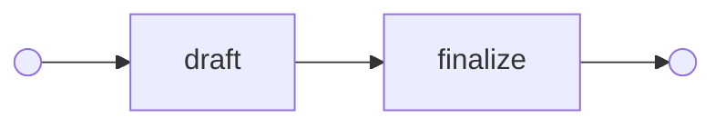
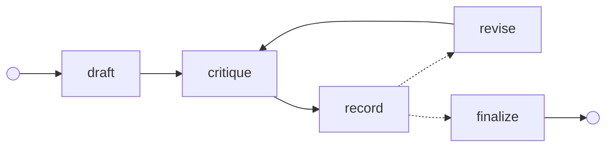
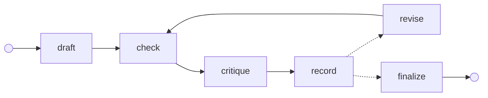
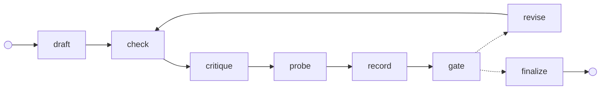

# Moment 01 · Critique an agent with a graph — then critique the critique

> **Question:** when a second node critiques an agent's work and the agent revises, does the work actually get better — and what kind of critique makes the difference?

An agent writes a small Python function from a spec. A critic reviews it. A router decides: revise, or stop. Built as an explicit **graph**, so each piece — who sees what, when the loop ends, what counts as evidence — is a node or an edge you can point at, test, and change.

## The four graphs

Same nodes, different wiring. Solid arrows always fire; dotted arrows are the router's choices.

**G0 · single shot** — no critique, the baseline.



**G1 · self-critique** — a critic that can only *read* the code.



**G2 · grounded critique** — the critic also sees the visible tests' results.



**G3 · probing critique + gate** — the critic's suspicions are *executed*, and the critique itself is checked before anyone acts on it.



## The nodes

| Node | What it does | Model call? |
|------|--------------|:-:|
| `draft` | writes the function from the spec and the visible tests | ✓ |
| `check` | runs the visible tests, and re-runs every earlier probe as a regression check | |
| `critique` | reviews the code and returns a structured critique: verdict + issues with evidence (+ probes in G3) | ✓ |
| `probe` | runs the critic's probes — e.g. `to_roman(40)` expecting `'XL'` — against the code | |
| `record` | appends one summary line per round (what the scoreboard and traces show) | |
| `gate` | **critiques the critique** — see below | |
| `revise` | rewrites the code from the critique's issues (and the failures, when there are any) | ✓ |
| `finalize` | records why the loop stopped | |

The router stops when the critic says **pass**, or at the **round budget** (4 drafts by default). Every step is **checkpointed**, so a run can be inspected, replayed, or resumed from any step.

## Critiquing the critique

A critic is a model too, with its own failure modes: it can be **lenient** (waves through code that passes the visible tests), **vague** ("could be cleaner"), or **wrong**. G3 doesn't answer that with yet another opinion; it answers it with code — the `gate` node:

- **No evidence, no issue.** Issues without evidence are dropped.
- **Evidence beats verdicts.** A failing test or probe always means *revise*, whatever the critic said.
- **Suspicions become facts.** Each probe the critic proposes is executed. A failing probe becomes a blocker issue with the exact input and output; a passing one is kept and re-run after every later fix.
- **Nothing actionable means done.** *Revise* with no issues left becomes *pass*.

The offline demo (`critique-graph demo`) plays exactly this story with a scripted model: the first draft passes every visible test but gets 40, 90, 400 and 900 wrong; the critic says **pass** — yet three of its own probes fail, so the gate overrides it and drops its one vague issue. The revision passes all 12 hidden tests.

```text
round 1: visible tests 1/1; critic said 'pass' with 1 issue(s) → gate: 3 of its probes failed, dropped 1 issue(s) with no evidence, overrode the verdict
round 2: visible tests 1/1; critic said 'pass' with 0 issue(s)
Stopped: critic passed. Hidden tests: 12/12.
```

## Who sees what

Graph engineering is mostly deciding what flows along each edge. Here every model call is a **fresh, single-turn conversation** that receives *artifacts* through the state, never a transcript:

| Node | Sees | Never sees |
|------|------|-----------|
| `draft` | spec, visible tests | hidden tests |
| `critique` (G1) | spec, code | test results |
| `critique` (G2, G3) | spec, code, visible-test results, probe results | the author's own explanation (`approach`) — so it can't defer to it |
| `revise` | spec, code, the (gated) issues, failures | hidden tests |

The hidden tests are used only by the grader, after the graph finishes. Tests pin each of these boundaries ([`test_graphs.py`](tests/test_graphs.py)).

## Tasks and grading

Four small functions with deliberately tricky edges — `to_roman` (subtractive forms, invalid input), `merge_intervals` (touching and contained intervals, unsorted input), `parse_csv_line` (quoted fields, escaped quotes, empty fields), `slugify` (accents, separators, word-boundary truncation).

Each task has **visible tests** the agent sees and **hidden tests** that grade the final code. The tasks are tested too: a reference solution must pass everything, and a plausible naive solution must pass the visible tests **and fail the hidden ones** — otherwise the eval couldn't tell good from lucky ([`test_tasks.py`](tests/test_tasks.py)).

## Hypotheses (to test with the live run)

These come from the literature; the experiment is how this repo checks them for itself.

1. **Self-critique alone helps little.** Without external feedback, models often fail to fix their own reasoning, and can even make it worse ([Huang et al., 2023](https://arxiv.org/abs/2310.01798)). Expect G1 ≈ G0, at higher cost.
2. **Grounded critique helps when the grounding has teeth.** Critique that uses tool or test feedback works better ([CRITIC, Gou et al., 2023](https://arxiv.org/abs/2305.11738); [Reflexion, Shinn et al., 2023](https://arxiv.org/abs/2303.11366)). But the visible tests here are deliberately weak, so expect G2 to inherit their blind spots.
3. **Probes are where the gain is.** A critic that proposes executable counterexamples turns suspicion into evidence. Expect G3 to solve the most tasks.
4. **Each round costs.** Expect calls and tokens to grow with the variant; judge by solved tasks per dollar, not per call ([Self-Refine, Madaan et al., 2023](https://arxiv.org/abs/2303.17651) reports gains from iterative refinement, but with a growing budget).

## Results

> **Not run yet against Claude** — the repo was built and tested offline. Run the experiment (below) and paste the scoreboard here, with the date and model.

| task | G0 | G1 | G2 | G3 |
|---|:-:|:-:|:-:|:-:|
| csv-line | | | | |
| merge-intervals | | | | |
| roman | | | | |
| slugify | | | | |
| **solved (hidden tests)** | | | | |
| model calls / est. cost | | | | |

What to look at besides the totals: how often the gate **overrode** the critic, how many issues it **dropped** as vague, and whether any round made the code **worse** (traces under `runs/`).

## Run it

```bash
uv run critique-graph demo                      # offline walkthrough of G3 — no API key, nothing measured
uv run critique-graph graph G3                  # print a graph as Mermaid

export ANTHROPIC_API_KEY=...                    # or: ant auth login
uv run critique-graph run roman --variant G3    # one run; check the cost before the full experiment
uv run critique-graph experiment --yes          # 4 tasks × 4 variants = 16 graph runs
```

Model-written code and probes run on your machine in a subprocess with a timeout — that isolates crashes and hangs, not malice. Use a container for anything untrusted.

## LangGraph, if you know it

The [graph runtime](../../src/agentic/graph.py) is ~150 lines so every mechanism stays visible. It maps one-to-one:

| Here | LangGraph |
|------|-----------|
| `Graph(entry=...)` + `.compile()` | `StateGraph(State)` + `.compile()` |
| `.node(name, fn)` — `fn(state) -> dict of updates` | `add_node(name, fn)` |
| `.edge(a, b)` | `add_edge(a, b)` |
| `.route(a, router, targets)` | `add_conditional_edges(a, router, targets)` |
| `END` | `END` |
| `run(..., on_step=...)` checkpoints + `resume(checkpoint)` | a checkpointer + `thread_id` |
| `max_steps` → `StepLimit` | `recursion_limit` → `GraphRecursionError` |

## How it calls Claude

[`ClaudeLLM`](../../src/agentic/llm.py) uses the official `anthropic` SDK (1.x): `claude-opus-5-5`, `effort` set explicitly (`medium`), **structured outputs** from Pydantic models (`messages.parse`), and **server-side refusal fallbacks** (`fallbacks: "default"`) so a declined request is retried on a recommended fallback model. It reads the stop reason *before* parsing, so a refusal or a cut-off reply surfaces as itself rather than as a JSON error.
